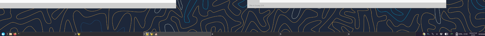
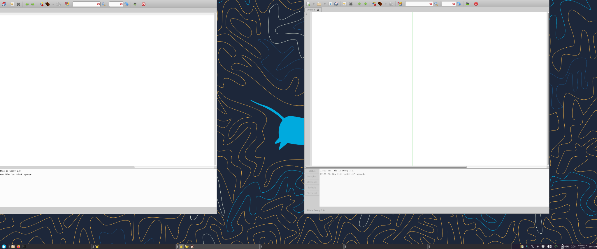

# Workspace Taskbar for Xfce

Workspace Taskbar is an Xfce panel plugin that combines workspace switching and window task buttons. Each workspace is represented by a persistent compartment containing one icon per window.



The plugin was **vibe coded with ChatGPT** to facilitate a personal transition from tint2 to `xfce4-panel`.. The original goal was to preserve a tint2-style workflow in which each desktop has a long, visually separate task area with its own window icons.

## Features

- Persistent, equal-width workspace compartments.
- One icon per window; no application grouping.
- Active workspace is visually distinguished.
- Active and urgent windows are highlighted.
- Click empty workspace area to switch workspace.
- Click a window icon to switch to its workspace and focus or restore it.
- Click the currently active window icon to minimize it.
- Right-click a window icon for the standard libwnck window action menu.
- Right-click empty workspace area for the normal Xfce plugin menu and **Swap with** submenu.
- Swap the contents of two workspaces while keeping workspace numbers and the active workspace fixed.
- Pinned windows appear on every workspace and are left untouched by swaps.
- Configurable workspace-number font size and spacing between window icons.



## Scope

Workspace Taskbar currently targets **X11-based Xfce sessions**. It uses libwnck for window and workspace information and operations, so Wayland support is not currently provided.

Multi-monitor behavior has not yet been tested systematically across different Xfce and window-manager configurations.

## Build dependencies

On Ubuntu 24.04 / Debian-based systems:

```bash
sudo apt install \
    build-essential meson ninja-build pkgconf xfce4-panel \
    libgtk-3-dev libxfce4panel-2.0-dev libwnck-3-dev
```

## Build and install

The canonical Meson build is:

```bash
meson setup build --prefix=/usr
meson compile -C build
sudo meson install -C build
xfce4-panel -r
```

Then open **Panel Preferences → Items → +** and add **Workspace Taskbar**.

For convenience, the repository also includes:

```bash
./install.sh
```

The convenience script checks both commands and development libraries. On APT-based systems it can offer to install missing build dependencies for you, then configures the build with `--prefix=/usr`, compiles the plugin, and installs it with `sudo`. It restarts `xfce4-panel` only when a panel process is already running, so the script can also be used before the first login to an Xfce session.

## Uninstall

```bash
./uninstall.sh
```

or, from a configured build directory:

```bash
sudo meson uninstall -C build
xfce4-panel -r
```

## Interaction summary

| Action | Result |
|---|---|
| Left-click empty workspace area | Switch to that workspace |
| Left-click inactive/minimized window icon | Switch, restore if needed, and focus |
| Left-click active window icon | Minimize |
| Right-click window icon | Standard window action menu |
| Right-click empty workspace area | Xfce plugin menu, including **Swap with** and **Properties** |

## Settings

Open the Xfce plugin context menu and choose **Properties**. The current settings are:

- workspace-number font size: 6–24 px;
- spacing between window icons: 0–16 px.

Settings are stored per panel-plugin instance.

## Workspace swapping

The **Swap with** submenu exchanges ordinary windows between two workspaces. Both sides are snapshotted before any move occurs. Workspace numbers remain fixed, the currently active workspace number does not change, and pinned windows are ignored.

Desktop and dock windows are excluded from swaps.

## License

GPL-2.0-or-later. See [COPYING](COPYING).
